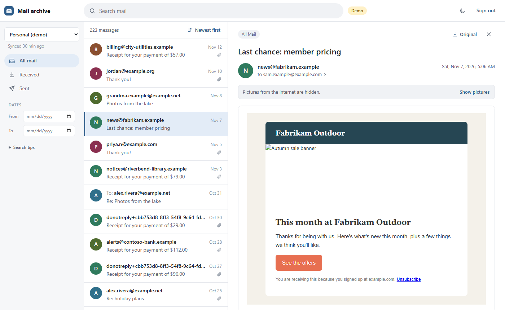

# mailview

A read-only web UI for [Mail-Archiver](https://github.com/s1t5/mail-archiver). Each person signs in with your
OpenID Connect provider and sees only their own archived mailboxes: search, read (HTML or text), preview and
download attachments, download the original message. Nothing can be changed or deleted.

mailview is an independent project, not part of Mail-Archiver.



## How it works

- mailview talks to Mail-Archiver's **read-only REST API** (`/api/v1`), never to its database.
- Every person has **their own Mail-Archiver user and API key**. mailview calls the API with the signed-in person's
  key, so **Mail-Archiver decides what each person may see**, and its Access Log names the person. mailview adds no
  access rules of its own beyond "who is signed in".
- Sign-in uses any **OpenID Connect** provider (Keycloak, Authentik, Authelia, Google, ...). An allowlist maps each
  provider user id to a label, and each label to that person's API key. Anyone not on the list is turned away.
- Email HTML is shown in a sandboxed frame with a strict Content Security Policy: scripts never run. Pictures from
  the internet are blocked until the reader asks for them, unless you set `REMOTE_IMAGES=allow`.
- Inline (`cid:`) images and the "Original" download are read from the stored original message, so these work best
  with Mail-Archiver's raw message storage (`RawMessages__Enabled=true`) switched on.

## Requirements

- Mail-Archiver **2611.2 or newer**, with the API enabled (`Api__Enabled=true`). Keep the default
  `Api__AllowAttachmentDownloads=true` and `Api__AllowMessageDownloads=true`.
- **Do not expose Mail-Archiver's `/api` to the internet.** API keys bypass Mail-Archiver's sign-in and two-factor
  authentication. mailview reaches the API over an internal Docker network; block `/api`, `/apidocs` and `/mcp` at
  your reverse proxy.
- An OpenID Connect provider where you can create a **confidential client**.
- A reverse proxy with **HTTPS** in front of mailview (`PUBLIC_URL` must be `https://`).

## Setup

### 1. The OpenID Connect client

Create a confidential client (client id + secret) with:

- Redirect URI: `https://<your mailview host>/auth/callback`
- Post-logout redirect URI: `https://<your mailview host>/`
- Scope: `openid` (nothing else is requested)

### 2. One Mail-Archiver user and API key per person

For each person:

1. In Mail-Archiver, create a normal (non-admin) user and assign their mailbox(es) to it.
2. Sign in to Mail-Archiver as that user and create an API key (API keys are per user and self-service).
3. Find the person's user id at your OpenID Connect provider: the `sub` claim of their ID token (Keycloak: Users →
   user → ID). If you don't know it, let them try to sign in: mailview logs
   `sign-in refused: user <id> is not set up`.
4. Pick a label for them (lowercase letters, digits and `-`, e.g. `alice`), add `<id>=alice` to `MAILVIEW_USERS`
   and set `MAILVIEW_KEY_ALICE` to their key. Restart mailview.

### 3. Run it

```yaml
services:
  mailview:
    image: ghcr.io/scottglz/mailview:0.2.0
    restart: unless-stopped
    env_file: mailview.env          # OIDC_CLIENT_SECRET and MAILVIEW_KEY_* (see .env.example)
    environment:
      PUBLIC_URL: https://mail.example.com
      OIDC_ISSUER: https://auth.example.com/realms/home
      OIDC_CLIENT_ID: mailview
      MAILARCHIVER_API_URL: http://mailarchive-app:5000/api/v1
      MAILVIEW_USERS: "3f2a1b4c-0000-4000-8000-000000000001=alice;3f2a1b4c-0000-4000-8000-000000000002=bob"
    read_only: true
    tmpfs:
      - /tmp
    cap_drop:
      - ALL
    security_opt:
      - no-new-privileges:true
    # Put it on the same Docker network as Mail-Archiver, and on your reverse proxy's network.
    # It listens on port 8080 (HTTP); health check: GET /healthz.
```

## Configuration

| Variable | Required | Default | Meaning |
|---|---|---|---|
| `PUBLIC_URL` | yes | | The address people open, `https://` only. Used for the OIDC redirect |
| `OIDC_ISSUER` | yes | | Your provider's issuer URL (discovery is read from `/.well-known/openid-configuration`) |
| `OIDC_CLIENT_ID` | yes | | |
| `OIDC_CLIENT_SECRET` | yes | | Keep it in an env file, not in the compose file |
| `MAILARCHIVER_API_URL` | yes | | Mail-Archiver's API base, e.g. `http://mailarchive-app:5000/api/v1` |
| `MAILVIEW_USERS` | yes | | `<provider user id>=<label>`, `;` between people. Ids are matched exactly (case-sensitive) |
| `MAILVIEW_KEY_<LABEL>` | one per label | | That person's Mail-Archiver API key. Label in upper case, `-` becomes `_`: `family-member-1` → `MAILVIEW_KEY_FAMILY_MEMBER_1`. A person without a key can't sign in; everyone else is unaffected |
| `APP_NAME` | | `Mail archive` | Name in the title bar and on the sign-in page |
| `APP_TAGLINE` | | `A searchable, read-only copy of your email.` | Line under the name on the sign-in page |
| `SIGN_IN_LABEL` | | `Sign in` | Text of the sign-in button, e.g. `Sign in with Google` |
| `SIGN_IN_ICON` | | `none` | `google` puts Google's logo on the button (for Google, or a provider that goes straight to Google) |
| `REMOTE_IMAGES` | | `ask` | `ask`: pictures from the internet are hidden until the reader clicks "Show pictures". `allow`: they load with the email, which lets senders' tracking pixels see that it was opened |
| `PORT` | | `8080` | |

Sessions are kept in memory: restarting mailview signs everyone out. Sessions last 7 days.

Signing out also ends the session at your provider when its discovery document has an `end_session_endpoint`.
Google has none, so with Google only mailview's session ends.

## Known limits

These come from Mail-Archiver's API and go away when it provides the data:

- Senders and recipients show as addresses, not names
  ([discussion #614](https://github.com/s1t5/mail-archiver/discussions/614)).
- Inline images need the stored original message, because the API doesn't list attachments' Content-IDs
  ([discussion #615](https://github.com/s1t5/mail-archiver/discussions/615)). Each original read shows up as a
  Download in Mail-Archiver's Access Log.

## Development

Node 24 (see `.nvmrc`). The server is TypeScript run directly by Node; only the web app has a build step.

```sh
npm ci
npm run demo        # builds, then serves made-up mail on http://localhost:8787 (no sign-in, no Mail-Archiver)
npm run dev:web     # in a second terminal: the web app with hot reload on http://localhost:5173
npm test            # server tests
npm run typecheck
```

Try the published image without any setup:

```sh
docker run --rm -p 8080:8080 -e MAILVIEW_DEMO=1 ghcr.io/scottglz/mailview:0.2.0
```

Then open http://localhost:8080.

Dependencies are pinned to exact versions, and `.npmrc` only installs releases that are at least 7 days old and
never runs install scripts.

## Support

This is a hobby project. Issues and pull requests are welcome, but there is no promise of a response time.
Security problems: see [SECURITY.md](SECURITY.md), please don't open a public issue.

## License

[MIT](LICENSE)
